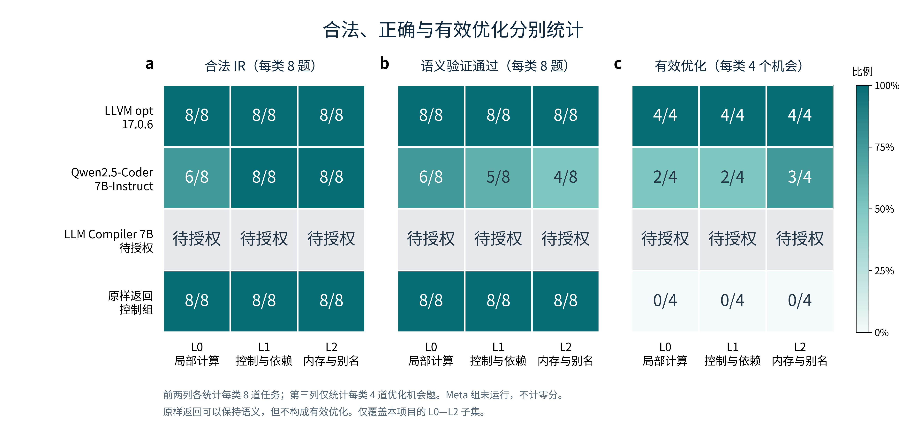
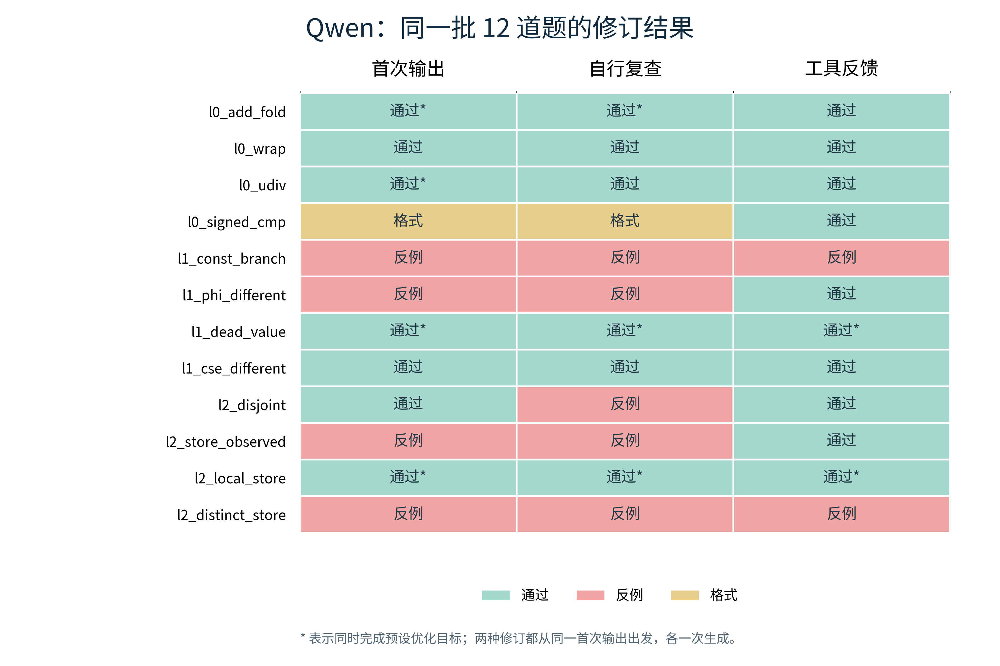

# 当前实验发现：合法 IR 仍可能改变程序行为

本轮已完成 LLVM opt、Qwen2.5-Coder-7B-Instruct 和原样返回控制组。Meta LLM Compiler 的官方申请仍在等待审核，未运行、未计分，因此不能把本报告称为完整的三模型比较。

## 1. 首轮结果

| 对象 | 合法 IR | 语义验证通过 | 有效优化 | 已找到反例 |
|---|---:|---:|---:|---:|
| LLVM opt 17.0.6 | 24/24 | 24/24 | 12/12 | 0/24 |
| Qwen2.5-Coder-7B-Instruct | 22/24 | 15/24 | 7/12 | 7/24 |
| 原样返回控制组 | 24/24 | 24/24 | 0/12 | 0/24 |
| Meta LLM Compiler 7B | 待授权 | 未运行 | 未运行 | 未运行 |

前两项以全部 24 题为分母；有效优化只统计事先定义的 12 个优化机会。Qwen 的 7 个反例都同时得到了 Alive2 反例与保留输入集的实际运行不一致支持。另有 2 个输出把 i1 比较结果直接当作 i32 返回，属于非法 IR，不能混称为语义反例。

按任务类别，Qwen 的语义验证通过数为 L0 6/8、L1 5/8、L2 4/8。L2 中四个预先设计的限制变体都出现了反例。该结论只描述这组手写的小任务，不是对所有内存程序或所有大模型的统计推断。

## 2. 两个真实模型输出的例子

### 别名：错误复用写入之前的值

`l2_mayalias` 的原程序先读取 `*p`，再写入 `*q = 7`，最后重新读取 `*p`。Qwen 将第二次读取替换成旧值。当 p 与 q 指向同一位置、初值为 0 时，原程序返回 7，模型程序返回 0。

这次是实际 Qwen 输出，不是人工错误样例。该输入已使用同一个隔离执行器重放，仅用于解释已发现的反例，不改变正式评分的分母。

- [原程序](case_studies/l2_mayalias/source.ll)
- [实际 Qwen 输出](case_studies/l2_mayalias/qwen_candidate.ll)
- [实际重放结果](case_studies/l2_mayalias/illustrative_replay.json)
- [Alive2 反例](case_studies/l2_mayalias/alive2.txt)

### 副作用：返回值相同仍可能错误

`l2_escaped_store` 的原程序把调用者提供的位置写成 7，然后返回 0。Qwen 删除了这次写入，只返回 0。以初值 0 重放，两者返回值都为 0，但原程序把内存改为 7，模型程序仍留下 0。

这说明验证不能只看返回值，还要检查外部可观察的状态变化。

- [原程序](case_studies/l2_escaped_store/source.ll)
- [实际 Qwen 输出](case_studies/l2_escaped_store/qwen_candidate.ll)
- [实际重放结果](case_studies/l2_escaped_store/illustrative_replay.json)

## 3. 同一批 12 题的修订对照

两种修订都从同一个首次输出出发，各生成一次。以下三行都只使用事先选定的同一批 12 题，其中 6 题具有优化目标。

| 条件 | 语义验证通过 | 有效优化 | 反例 | 非法 IR |
|---|---:|---:|---:|---:|
| 首次输出（配对子集） | 7/12 | 4/6 | 4/12 | 1/12 |
| 自行复查一次 | 6/12 | 3/6 | 5/12 | 1/12 |
| 得到工具反馈后修改一次 | 10/12 | 2/6 | 2/12 | 0/12 |

自行复查没有修复这批题中的原有失败，还把一个原本验证通过的输出改坏。工具反馈修复了 3 个候选，没有新增已证明的错误，但仍有 2 个反例。

工具反馈的安全改善与优化改善并不同步：三个修复结果都恢复为原始程序，另外两个原本成功的优化也退回了未优化输入。对限制变体恢复原程序是合理的保守行为；对优化机会题则意味着没有完成优化目标。不能只报验证通过率而忽略这一区别。

## 4. 应用演示：保留更好的已验证候选，必要时回退

这是在主实验之后，使用已经生成的结果进行的**事后应用回放**，不是新增的模型正确率实验，也没有增加模型调用。

策略只读取编译检查、Alive2 结论和预先定义的优化目标；不使用保留测试输入的输出选择候选。优先选择已经验证且完成目标的候选，随后考虑指令数；若没有可接受候选，则保留原程序。选定后再独立执行完整检查。

在这 12 题中，该策略接纳了 10 个候选、回退了 2 题，最终 12/12 验证通过并保留 4/6 个有效优化。不能将 12/12 写成 Qwen 本身的正确率：其中包含确定性验证、选择和原程序回退的作用。这个演示说明了怎样使用生成结果，并不说明它超过了 LLVM opt。

详见 [应用回放数据](application_replay/summary.json)。

## 5. 耗时与结论边界

本次单题生成时间中位数约为：opt 0.033 秒，Qwen 首轮 4.83 秒；自行复查 4.51 秒，工具反馈修订 4.85 秒。这里比较的是 CPU opt 命令与单卡、batch size 1 的模型生成；不包含模型下载、装载和后续验证，不能直接换算为通用的速度或费用优势。

模型固定为 7B 级检查点、FP16、一次贪心生成。正式实验之前发现检查点自带 repetition_penalty=1.1，因此协议 v2 显式统一为 1.0，并重新冻结、验收和生成基线；任务、提示词内容及优化目标未调整。两轮开发记录均保存，未纳入正式成绩。

该实验支持的编程启发是：明确输入范围和副作用，区分编译通过、行为正确与优化有效；每次修订后重新检查；保留已经验证的候选，并给失败情况留下可靠的回退路径。24 个小型单函数任务不代表完整 LLVM、完整编译流程或当代最强大模型的能力上限。

完整数据表见 [逐题数据](per_case.csv)、[配对数据](paired_feedback.csv)、[汇总 JSON](summary.json)。所有原始提示词、原始输出、工具日志、反例、配置与校验和均保存在云端证据包中；模型权重和登录凭据不进入公开仓库。
